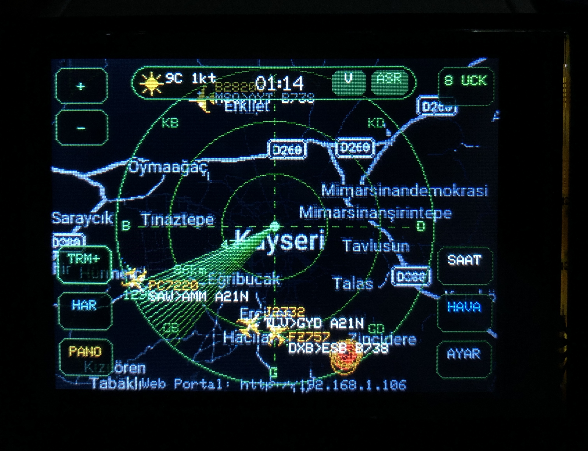
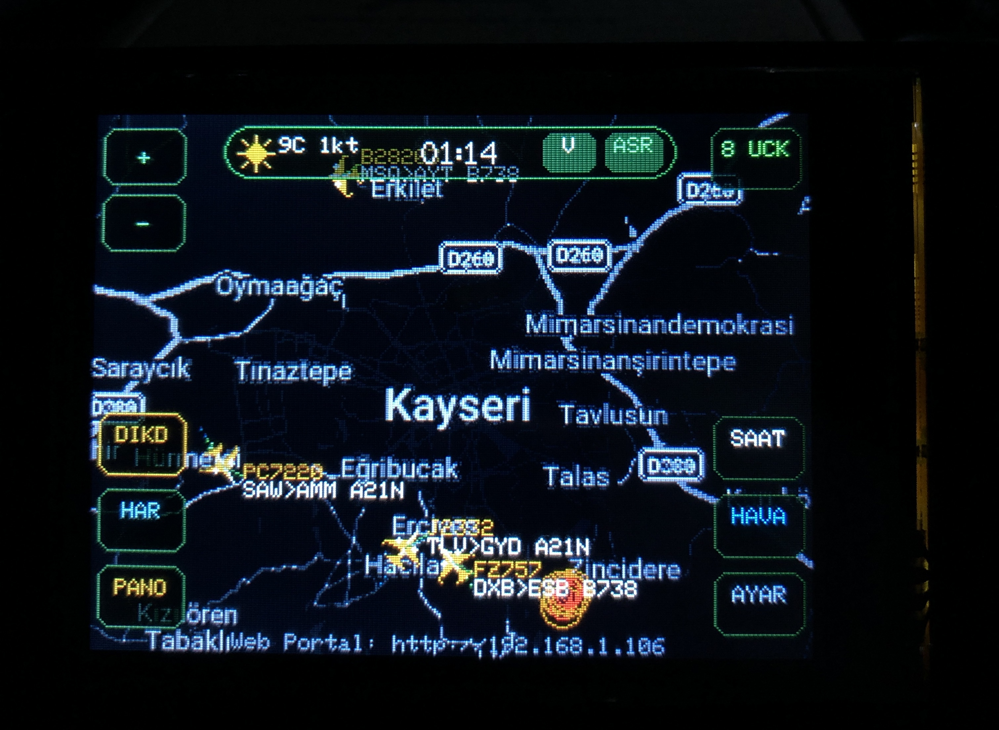
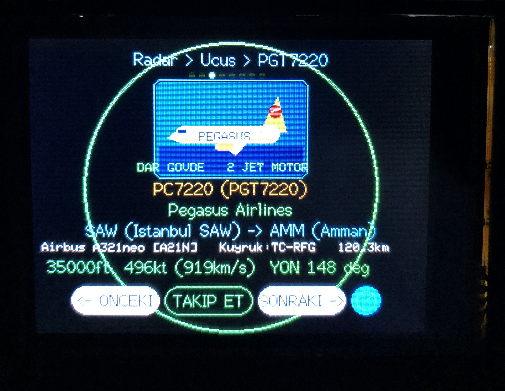
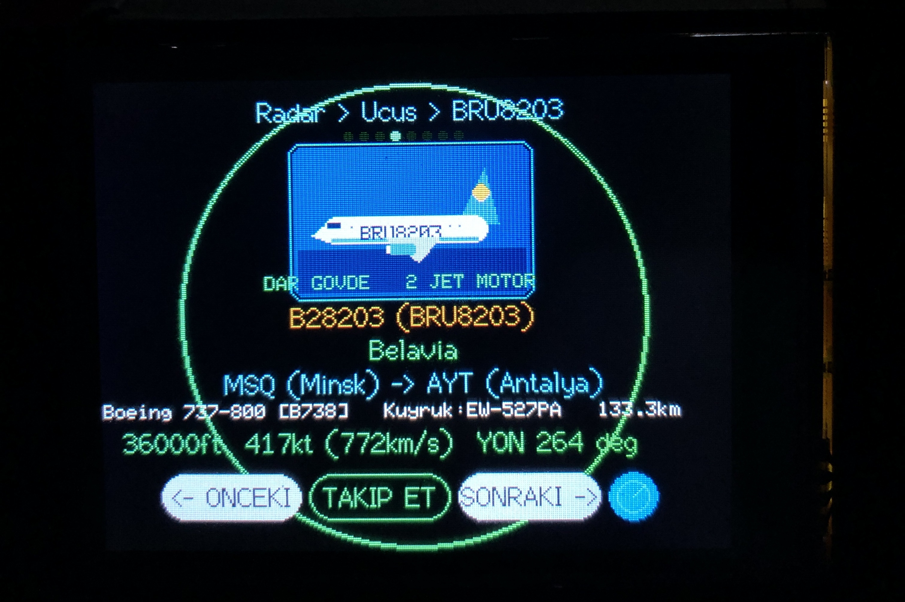
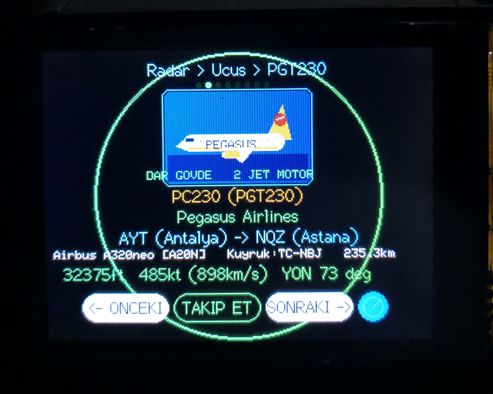
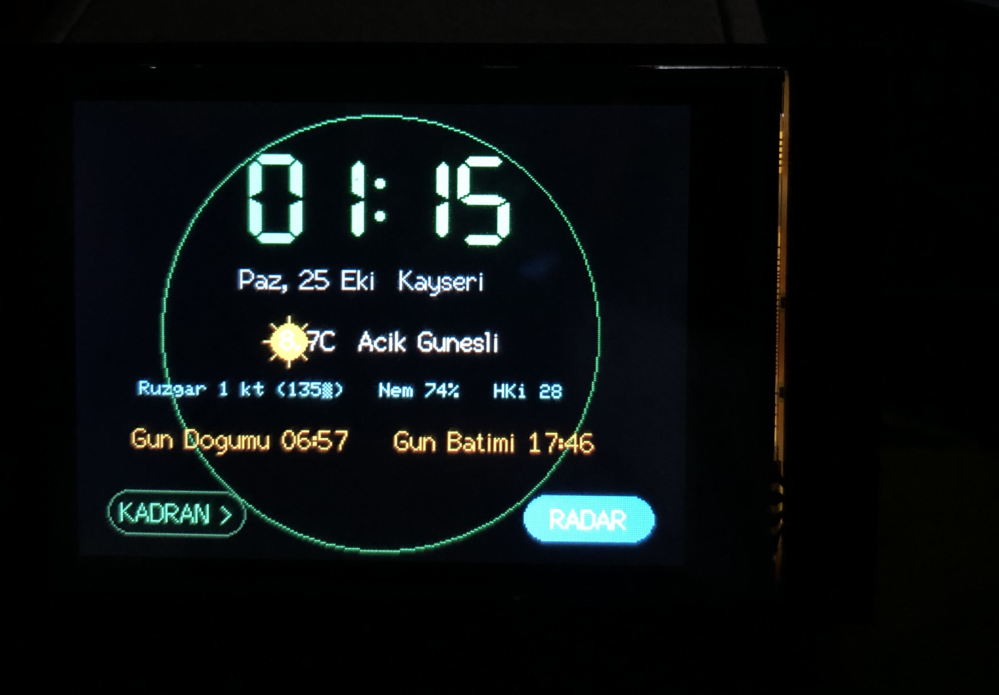
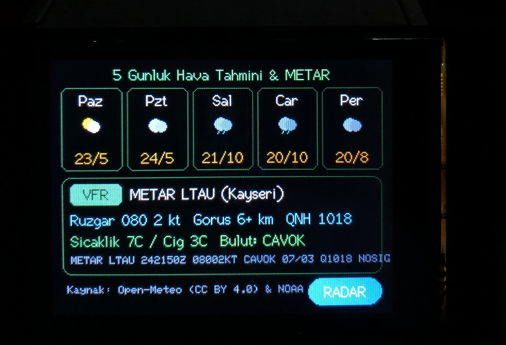
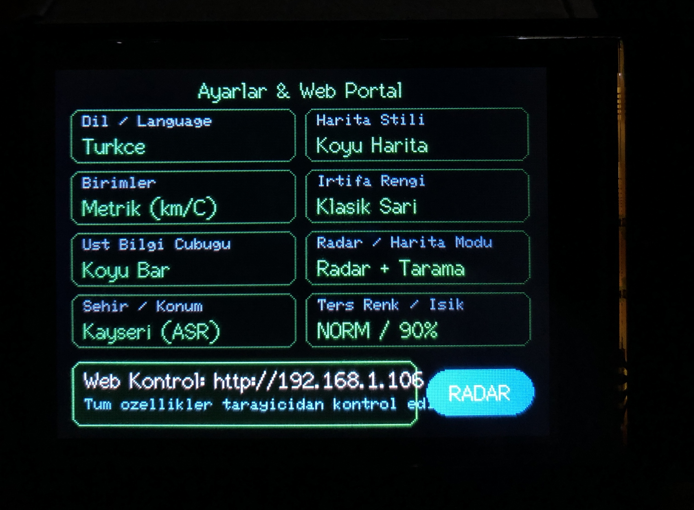

# FlightScnr_CYD ✈️📡
### ESP32 CYD 2.8" (`ESP32-2432S028R`) Canlı Uçuş Radarı, Gerçek Dark-Mode Harita & Havacılık Hava Durumu İstasyonu
*(Live ADS-B Flight Radar, True Dark-Mode Maps, Airline Livery Cards & Aviation Weather Tracker for the ESP32 2.8" Cheap Yellow Display)*

[](https://creativecommons.org/licenses/by-nc-sa/4.0/)
[](https://platformio.org/)
[-38bdf8.svg)](#donanım-ve-pin-yapısı--hardware--pinout)
[-22c55e.svg)](https://github.com/yashmulgaonkar/FlightScnr_Pi)

---

## 🙏 Teşekkür, İlham Kaynağı ve Lisans / Attribution & Credits

> [!IMPORTANT]
> **Orijinal Proje & Eser Sahibi / Original Project & Author:**
> Bu proje, **[Yash Mulgaonkar (@yashmulgaonkar)](https://github.com/yashmulgaonkar)** tarafından geliştirilen muazzam **[FlightScnr_Pi](https://github.com/yashmulgaonkar/FlightScnr_Pi)** *(Raspberry Pi masaüstü uçuş radarı)* ve **[FlightScnr](https://github.com/yashmulgaonkar/FlightScnr)** projelerinden ilham alınarak, **ESP32-2432S028R (2.8" Cheap Yellow Display - CYD)** mikrodenetleyici donanımına C++ / Arduino / FreeRTOS mimarisiyle sıfırdan uyarlanmış (port edilmiş) bir türev çalışmadır.
>
> - **Orijinal Raspberry Pi Projesi:** [https://github.com/yashmulgaonkar/FlightScnr_Pi](https://github.com/yashmulgaonkar/FlightScnr_Pi)
> - **Orijinal FlightScnr Projesi:** [https://github.com/yashmulgaonkar/FlightScnr](https://github.com/yashmulgaonkar/FlightScnr)
> - **Orijinal Telif Hakkı:** `Copyright (c) 2026 Yash Mulgaonkar`
> - **CYD 2.8" (`ESP32-2432S028R`) C++ Uyarlaması & Geliştirmeler:** [Mehmethan Aytekeli (@mehmethanaytekeli)](https://github.com/mehmethanaytekeli)
> - **Lisans:** **[Creative Commons Attribution-NonCommercial-ShareAlike 4.0 International (CC BY-NC-SA 4.0)](LICENSE)**
> - ⚠️ **Ticari Kullanım Yasağı (Non-Commercial):** Orijinal yazar **Yash Mulgaonkar**'dan yazılı izin alınmaksızın bu yazılımın veya donanım uyarlamasının **ticari amaçlarla satılması veya kullanılması kesinlikle yasaktır.**

---

## 📸 Cihaz Üzerinden Gerçek Görseller / Live Photos on CYD 2.8" Hardware

| Dairesel Radar + Gerçek Dark Harita (`TRM+`) | Tam Ekran Dikdörtgen Gerçek Dark Harita (`DIKD`) |
| :---: | :---: |
|  |  |
| **Uçuş Detay Kartı — Pegasus A321neo (`TC-RFG`)** | **Uçuş Detay Kartı — Belavia Boeing 737-800** |
|  |  |
| **Uçuş Detay Kartı — Pegasus A320neo (`TC-NBJ`)** | **Dijital Havacılık Saati & Anlık Hava Durumu** |
|  |  |
| **5 Günlük Tahmin & Canlı Havalimanı METAR (`LTAU`)** | **Cihaz Üzeri Türkçe Ayarlar & Web Portal Bilgisi** |
|  |  |

---

## ✨ Özellikler / Key Features

### 🇹🇷 Türkçe Özet
1. **Gerçek Zamanlı Canlı Uçuş Radarı (FlightRadar24 + adsb.fi):**
   - Her 5 saniyede bir bölgenizdeki canlı ADS-B uçuşlarını çeker ve 5 saniyelik API güncellemeleri arasında **30 FPS ölü hesaplama (dead-reckoning) konum yumuşatma** ile uçakları ekranda akıcı şekilde hareket ettirir.
   - Menzil (`+` / `-` tuşları ile `15 km` – `350 km` arası yakınlaştırma/uzaklaştırma) değiştiğinde yalnızca o anki kadrajda bulunan uçaklar filtrelenir; köşe birikmesi yapmaz.
2. **Gerçek Koyu Tema (True-Black Dark Mode) Harita Motoru:**
   - PSRAM bulunmayan standart ESP32 (520 KB SRAM) üzerinde TLS/HTTPS bağlantılarının çökmemesi için `320×240` çözünürlüklü 4-bit indekslenmiş gerçek şehir/yol haritaları (`PROGMEM` Flash bellekte) ve `320×40` şerit tamponlama (*strip-buffer*) mimarisi kullanır.
   - **2 Farklı Radar Görünüm Modu:**
     - **Dairesel Radar Modu (`YUVR` + `TRM+`/`TRM-`):** Gerçek dark-mode harita üzerinde yeşil radar halkaları ve açılıp kapatılabilen döner fosforlu radar tarama huzmesi.
     - **Tam Ekran Dikdörtgen Harita Modu (`DIKD`):** Dairesel radar çerçevesini ve yeşil halkaları kaldırarak tüm `320×240` ekranı gerçek dark-mode yol/şehir haritası ve uçaklara ayırır.
3. **Uçak Tipine, Boyutuna ve Havayolu Firmasına Göre Özel İkonlar & Detay Kartı:**
   - Radar ekranında uçaklar; **Helikopter** (döner rotorlu), **Geniş Gövde / 4 Motorlu Jet** (`B747`, `A380`, `A340`), **Standart Yolcu Jeti** (`B738`, `A320`, `A21N`), **Turboprop / Pervaneli** (`ATR`, `C172`) ve **Askeri / Avcı Jeti** olarak gerçek silüetleriyle çizilir.
   - Bir uçağa dokunup **`DETAY`** sayfasına girdiğinizde; uçağın **gövde sınıfı** (`DAR GÖVDE`, `GENİŞ GÖVDE`, `HELİKOPTER`, `HAFİF UÇAK`), **motor sayısı/tipi** (`2 JET MOTOR`, `4 MOTOR`, `PERVANELİ`, `TURBOSHAFT`) ve **taşıyıcı havayolu firmasının kuyruk logosu ve renkleri** (*Pegasus, Türk Hava Yolları, AJet, SunExpress, Belavia, Emirates, Qatar, Lufthansa, Ryanair, British Airways* vb.) dinamik olarak çizilir.
   - Kalkış/varış havalimanları (`SAW -> AMM`, `MSQ -> AYT`), çağrı kodu, tescil (`TC-RFG`), irtifa (`ft`/`m`), yer hızı (`kt`/`km/s`), dikey hız (`fpm`), baş açısı ve mesafe bilgileri tam ekranda gösterilir.
4. **%100 Uzaktan Web Sunucusu Kontrolü (Dokunmadan Kiosk Kullanımı):**
   - Cihazı duvara veya masaüstüne koyup hiç dokunmadan aynı Wi-Fi ağındaki telefon veya bilgisayardan `http://<CIHAZ_IP_ADRESI>` (veya `http://flightscnr.local`) adresine girerek:
     - Tüm ekranlar arasında geçiş yapabilir (`Radar`, `Saat`, `Tahmin/METAR`, `Pano`, `Uçuş Detay`),
     - Radar yakınlaştırma (`Zoom + / -`), tarama huzmesi (`Aç/Kapat`), harita çerçeve tipi (`Dairesel / Tam Ekran Dikdörtgen`), harita stili (`Carto Dark`, `OSM Dark`, `Voyager`, `VFR`, `Düz Siyah`),
     - Şehir / Havalimanı (`Kayseri LTAU`, `İstanbul LTFM`, `Ankara LTAC`, `Antalya LTAI`, `New York KJFK` veya özel enlem/boylam),
     - Ekran parlaklığı, sesli uyarılar ve **7 dil seçeneği (Türkçe 🇹🇷 dahil)** ayarlarını anında değiştirebilirsiniz.
5. **5 Havacılık Saati, 5 Günlük Hava Tahmini, Canlı NOAA METAR & Split-Flap Havalimanı Panosu:**
   - **Saat Modları:** Dijital Saat + Hava Durumu, Analog Saat, Kokpit Altimetre Saati, Flieger Pilot Saati, Gerçek Zamanlı Ay Evresi.
   - **Hava & METAR:** Open-Meteo 5 günlük tahmin + AviationWeather.gov canlı havalimanı METAR ve uçuş kategorisi (`VFR`, `MVFR`, `IFR`, `LIFR`).
   - **Deprem Katmanı:** USGS üzerinden son 24 saatteki sismik aktivite bildirimleri.

---

### 🇬🇧 English Overview
- **Dual-Core FreeRTOS Architecture on Standard ESP32 (No PSRAM Required):**
  - **Core 0 (`networkTask`):** Handles HTTPS/TLS JSON streams (`FlightRadar24`, `adsb.fi`, `Open-Meteo`, `AviationWeather.gov METAR`, `USGS Earthquakes`) with `http.useHTTP10(true)` stream parsing to fit comfortably inside 520 KB SRAM.
  - **Core 1 (`loop`):** Renders a smooth 30 FPS UI using a `320×40` 16-bit RGB565 strip-buffer (`TFT_eSprite`) and a custom bit-banged SPI touch driver (`readCydTouch`) that eliminates ESP32 `GPIO 36`/`39` ADC/Wi-Fi interrupt conflicts.
- **True-Black 4-Bit Indexed Real Maps in `PROGMEM`:** Crisp dark-mode road and city maps stored directly in Flash (`include/real_map_tiles.h`), plus a Python generator (`tools/generate_dark_map_tiles.py`) to build tiles for any coordinates worldwide.
- **Dynamic Aircraft Silhouette & Airline Livery Engine:** Distinguishes Helicopters, 4-Engine Heavies, Narrow-body Twinjets, Turboprops, Light GA props, and Fighter Jets both on the radar scope and in the Flight Detail card, complete with airline tail-fin liveries.
- **Full Web Portal Remote Control (`http://<device-ip>`):** Configure and control every button, zoom level, map mode, location, and language remotely from your phone or PC browser.

---

## 🛠️ Donanım ve Pin Yapısı / Hardware & Pinout

Bu proje **ESP32-2432S028R (2.8 inç 320×240 TFT LCD "Cheap Yellow Display" - CYD)** kartlarının hem **Tek USB (Micro-USB)** hem de **Çift USB (Micro-USB + Type-C)** versiyonlarıyla tam uyumludur.

| Bileşen / Component | ESP32 GPIO Pini | Açıklama / Notes |
| :--- | :--- | :--- |
| **TFT Sürücüsü (Display Driver)** | `ILI9341_2` (`cyd_ili9341`) / `ST7789` (`cyd_st7789`) | 320×240 16-bit RGB565, 40 MHz HSPI |
| **TFT SPI Pinleri** | `MOSI=13`, `SCLK=14`, `CS=15`, `DC=2`, `RST=-1` | Donanımsal HSPI hattı |
| **TFT Arka Işık (Backlight)** | `GPIO 21` | PWM parlaklık kontrolü (`LEDC Kanal 0`) |
| **Dokunmatik (XPT2046 Touch)** | `CLK=25`, `MOSI=32`, `MISO=39`, `CS=33`, `IRQ=36` | Özel bit-bang SPI okuyucu (`readCydTouch`) |
| **RGB Bildirim LED'i** | `R=4`, `G=16`, `B=17` | Aktif-Düşük (Active-Low) |
| **LDR Işık Sensörü** | `GPIO 34` | Ortam ışığına göre `0–255` arası otomatik ekran parlaklığı (PWM) |
| **Dahili Hoparlör / Amfi** | `GPIO 26` | Radar uyarı tonları |

---

## 🚀 Kurulum Rehberi (Adım Adım CYD'ye Yükleme) / Step-by-Step Installation Guide

Bu projeyi kendi **ESP32 CYD 2.8"** ekranınıza yüklemek için **2 farklı yöntem** kullanabilirsiniz:

### Yöntem 1: PlatformIO ile Tek Tıkla Derleme ve Yükleme (Önerilen)

1. **Gereksinimler:**
   - Bilgisayarınızda [VS Code](https://code.visualstudio.com/) ve **[PlatformIO IDE](https://platformio.org/install/ide?install=vscode)** eklentisi (veya Python + PlatformIO Core CLI) kurulu olmalıdır.
   - CYD kartınızı veri destekli bir USB-C veya Micro-USB kablosuyla bilgisayarınıza bağlayın.

2. **Projeyi İndirin (Clone):**
   ```bash
   git clone https://github.com/mehmethanaytekeli/FlightScnr_CYD.git
   cd FlightScnr_CYD
   ```

3. **(İsteğe Bağlı) Wi-Fi Bilgilerinizi Kod İçinden Tanımlama:**
   - Hiç kod değiştirmeden yüklerseniz cihaz ilk açılışta otomatik olarak **`FlightScnr-CYD`** adında şifresiz bir Wi-Fi erişim noktası (AP) açar; telefonunuzla bu ağa bağlanıp `http://192.168.4.1` adresinden ev Wi-Fi şifrenizi girebilirsiniz.
   - Eğer Wi-Fi ağınızı derleme sırasında doğrudan gömmek isterseniz [`include/config.h`](include/config.h) dosyasındaki şu iki satırı düzenleyin:
     ```cpp
     #define DEFAULT_WIFI_SSID   "EV_WIFI_ADINIZ"
     #define DEFAULT_WIFI_PASS   "WIFI_SIFRENIZ"
     ```

4. **Cihaza Yükleyin:**
   - **Windows'ta Tek Tıkla Yükleme:** Klasör içindeki [`flash_cyd.bat`](flash_cyd.bat) dosyasına çift tıklayın.
   - **Komut Satırından (CLI) Yükleme:**
     ```bash
     # Çift USB'li (Micro-USB + Type-C) veya standart ILI9341 CYD modelleri için:
     pio run -e cyd_ili9341 -t upload

     # Eğer ekranınız ST7789 sürücülü yeni revizyon CYD ise:
     pio run -e cyd_st7789 -t upload
     ```
   > 💡 **İpucu:** Yükleme sırasında terminalde `Connecting.....` yazısı çıktığında kartın arkasındaki küçük **`BOOT`** tuşuna 1-2 saniye basılı tutun, yükleme (`Writing at 0x00010000...`) başlayınca bırakın.

---

### Yöntem 2: Kod Derlemeden Hazır `.bin` Dosyası ile Yükleme (`prebuilt/`)

PlatformIO kurmak istemiyorsanız [`prebuilt/`](prebuilt/) klasöründeki hazır derlenmiş binary dosyalarını **esptool.py** veya **[ESP Web Flasher](https://esp.huhn.me/)** ile doğrudan yükleyebilirsiniz:

```bash
esptool.py --chip esp32 --baud 460800 write_flash -z \
  0x1000  prebuilt/bootloader.bin \
  0x8000  prebuilt/partitions.bin \
  0x10000 prebuilt/firmware_cyd_ili9341.bin
```

---

## 🌐 İlk Kurulum ve Web Portal Kullanımı / First Boot & Web Portal

1. **Wi-Fi Bağlantısı:**
   - Cihaz açıldığında kayıtlı bir Wi-Fi bulamazsa **`FlightScnr-CYD`** adında bir Wi-Fi ağı yayınlar.
   - Telefonunuzdan veya bilgisayarınızdan **`FlightScnr-CYD`** ağına bağlanın ve tarayıcıdan **`http://192.168.4.1`** adresine gidin.
   - Ev Wi-Fi ağınızı (SSID), şifrenizi, bulunduğunuz şehrin enlem/boylamını ve havalimanı kodunu (`LTAU`, `LTFM`, `LTAC`, `LTAI` vb.) girip **Kaydet**'e basın.
2. **Uzaktan Kontrol (Web Sunucusu):**
   - Cihaz ev Wi-Fi ağınıza bağlandığında sağ üstteki **`AYAR`** (`Settings`) ekranında cihazın aldığı yerel IP adresi (ör. `http://192.168.1.33`) yazar.
   - Aynı ağdaki herhangi bir tarayıcıdan bu IP adresine girerek cihaza hiç dokunmadan:
     - Radar yakınlaştırma/uzaklaştırma (`Zoom + / -`),
     - Döner tarama huzmesini açma/kapatma (`TRM+ / TRM-`),
     - Dairesel Radar (`YUVR`) veya Tam Ekran Dikdörtgen Harita (`DIKD`) seçimi,
     - Ekran değiştirme (`Radar`, `Saat`, `Tahmin/METAR`, `Pano`, `Uçuş Detay`),
     - Dil seçimi (`Türkçe`, `English`, `Deutsch`, `Français`, `Español`, `Nederlands`, `Magyar`) işlemlerini anında yapabilirsiniz.

---

## 🗺️ Kendi Şehriniz İçin Gerçek Dark-Mode Harita Üretme / Generating Custom City Maps

Varsayılan olarak `PROGMEM` içerisinde **Kayseri (Zoom 7–12)**, **İstanbul**, **Ankara**, **Antalya** ve **New York** gerçek dark-mode harita karoları yer alır. Kendi şehrinizin gerçek yol haritasını eklemek için:

1. [`tools/generate_dark_map_tiles.py`](tools/generate_dark_map_tiles.py) dosyasını açın ve `CITIES_AND_ZOOMS` listesine kendi koordinatlarınızı ekleyin.
2. Python betiğini çalıştırın:
   ```bash
   pip install pillow
   python tools/generate_dark_map_tiles.py
   ```
3. Betik otomatik olarak [`include/real_map_tiles.h`](include/real_map_tiles.h) dosyasını güncelleyecektir. Ardından `pio run -e cyd_ili9341 -t upload` ile cihazınıza yükleyin.

---

## 📂 Proje Klasör Yapısı / Project Structure

```text
FlightScnr_CYD/
├── docs/images/                 # CYD 2.8" donanımı üzerinden çekilen gerçek ekran fotoğrafları
├── include/
│   ├── config.h                 # Donanım pinleri, sabitler ve veri yapıları
│   ├── real_map_tiles.h         # PROGMEM'de saklanan 320x240 4-bit gerçek dark-mode haritalar
│   ├── audio_engine.h           # PWM ses/uyarı motoru başlığı
│   ├── network_manager.h        # Core 0 HTTPS/JSON API istemcisi başlığı
│   ├── ui_renderer.h            # Core 1 30 FPS strip-buffer grafik motoru başlığı
│   └── web_portal.h             # Dahili Türkçe/Çok dilli Web Sunucusu başlığı
├── src/
│   ├── main.cpp                 # Başlatma, bit-bang XPT2046 dokunmatik sürücüsü, NVS ayarları
│   ├── network_manager.cpp      # FR24, adsb.fi, Open-Meteo, NOAA METAR, USGS veri çekici
│   ├── ui_renderer.cpp          # Radar, gerçek harita, uçak/helikopter kartları, saat ve METAR çizimi
│   ├── web_portal.cpp           # Uzaktan kontrol ve yapılandırma web arayüzü
│   └── audio_engine.cpp         # Ses efektleri
├── tools/
│   └── generate_dark_map_tiles.py # Herhangi bir şehir için PROGMEM dark-mode harita üretici
├── prebuilt/                    # Derlemeden doğrudan yüklenebilir hazır .bin dosyaları
├── simulator/index.html         # Tarayıcı tabanlı önizleme simülatörü
├── flash_cyd.bat                # Windows için tek tıkla yükleme betiği
├── platformio.ini               # PlatformIO yapılandırması (cyd_ili9341 & cyd_st7789)
├── LICENSE                      # CC BY-NC-SA 4.0 Lisans metni
└── NOTICE                       # Telif hakkı ve veri kaynağı bildirimleri
```

---

## 📜 Lisans ve Veri Kaynakları / License & Data Sources

- **Lisans:** Bu proje, orijinal **[FlightScnr_Pi](https://github.com/yashmulgaonkar/FlightScnr_Pi)** projesiyle aynı şekilde **[Creative Commons Attribution-NonCommercial-ShareAlike 4.0 International (CC BY-NC-SA 4.0)](LICENSE)** lisansı altında sunulmaktadır.
  - **Atıf (Attribution):** Orijinal eser sahibi **Yash Mulgaonkar**'a ve orijinal depoya bağlantı verilmesi zorunludur.
  - **Ticari Olmayan Kullanım (NonCommercial):** Ticari amaçlarla satışı ve kullanımı kesinlikle yasaktır.
  - **Aynı Lisansla Paylaşım (ShareAlike):** Türev çalışmalar aynı lisans (`CC BY-NC-SA 4.0`) ile paylaşılmalıdır.
- **Veri Kaynakları:**
  - Canlı Uçuş Verileri: [Flightradar24](https://www.flightradar24.com/) & [adsb.fi](https://adsb.fi/)
  - Hava Durumu & Hava Kalitesi: [Open-Meteo.com](https://open-meteo.com/) (CC BY 4.0)
  - Havacılık METAR Verileri: [NOAA / AviationWeather.gov](https://aviationweather.gov/)
  - Deprem Verileri: [USGS Earthquake Hazards Program](https://earthquake.usgs.gov/)
